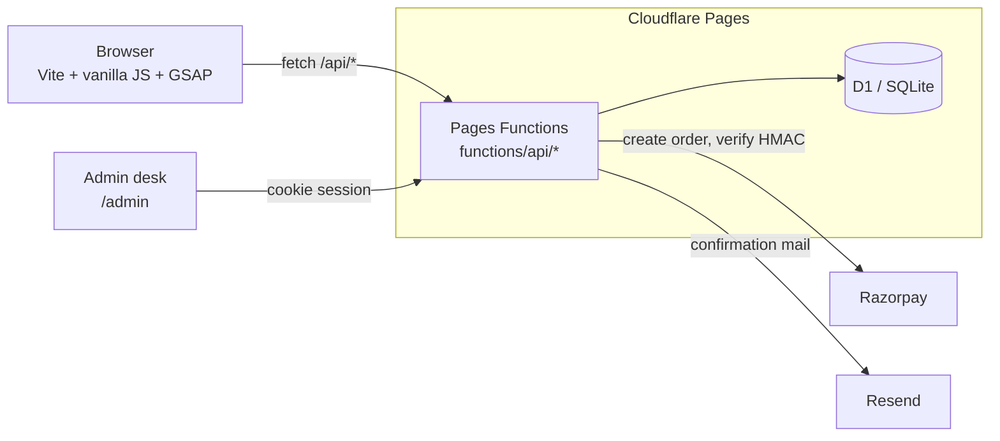

# MOMOYA

A full-stack ordering site for a concept momo house, built to show end-to-end product work: a design-led front end, a real API, a database, payments, an admin side, transactional email, tests and CI.

**Live demo:** https://momoya.pages.dev  ·  **Kitchen desk (admin):** `/admin/`

> MOMOYA is a concept brand by [WebnexStudio](https://www.webnexstudio.in). Nothing is delivered and no real money moves. The UI says so wherever money is involved.

## What it does

| Area | Behaviour |
| --- | --- |
| **Ordering** | Menu with add-to-cart, quantity editing, free delivery over ₹499, 5% GST. Cart survives reloads. |
| **Payment** | Razorpay (test mode) with server-side HMAC verification when keys are set; otherwise a built-in test gateway with a failure path and retry. |
| **Tracking** | Look an order up by order ID + phone. Status is set by the kitchen in the admin; if nobody touches it, it auto-advances so the demo still moves. |
| **Booking** | Live per-slot availability, 8 tables per slot, closed Mondays. The last table cannot be double-booked. |
| **Reviews** | Stars + text, link ban, honeypot, per-IP rate limit. "Ordered here" badge only for a real paid or COD order ID with the matching phone. |
| **Admin** | Password-protected desk: live orders (new-order flash + beep), status control, cancel, bookings, review moderation, daily stats. |
| **Email** | Order and booking confirmations through Resend. Entirely optional; a mail failure never fails an order. |

## Architecture



One repo, one deploy. Static assets and the API ship together, so there is no CORS and no separate server to run.

```
index.html, src/        storefront (shop.js = cart, checkout, payment, tracker, reviews)
public/admin/           kitchen desk (single page, no build step)
functions/api/          orders, pay, bookings, reviews, menu
functions/api/admin/    login, orders, bookings, reviews + auth middleware
functions/_lib/         util (catalogue, validation, auth), mail
schema.sql              fresh install        migrations/   changes for an existing database
test-api.mjs            end-to-end API tests (run in CI)
```

## Decisions worth a look

- **The server owns the catalogue.** The browser sends item IDs and quantities only. Prices, delivery, tax and the total are recomputed on the server, so editing the page cannot change what you pay (there is a test for it).
- **Payments are verified, not trusted.** With Razorpay the order is created server-side and `/api/pay` checks the HMAC signature before marking it paid. The test gateway is only used when no keys exist.
- **Double-booking is prevented in SQL.** The booking is one `INSERT ... SELECT ... WHERE capacity_left >= need` statement, so two simultaneous requests cannot both take the last table.
- **Admin auth is small and deliberate.** Password in a Cloudflare secret, compared via hashes; session is an HMAC-signed expiry in an `HttpOnly; Secure; SameSite=Strict` cookie; failed logins are throttled per IP (5 per 15 minutes); writes require `application/json`, which blocks cross-site form posts.
- **Customer lookups need two facts.** Order ID plus the phone it was placed with.
- **User text is never parsed as HTML.** The UI builds DOM with `textContent`; the server strips angle brackets and email bodies are escaped.
- **Optional integrations degrade quietly.** No Razorpay keys → test gateway. No Resend key → no emails. The core flow works either way.

## Run it locally

```bash
npm install
cp .dev.vars.example .dev.vars   # set ADMIN_PASSWORD
npm run db:local                 # create tables in the local D1
npm run api                      # build + serve site and API at http://localhost:8788
ADMIN_PASSWORD=... npm run test:api   # 40+ end-to-end checks (use a fresh DB)
```

`npm run dev` runs the storefront alone (Vite, no API).

## Deploy

```bash
npx wrangler d1 create momoya                      # put the id in wrangler.toml
npx wrangler d1 execute momoya --remote --file=schema.sql
npm run deploy
.\set-secret.ps1 ADMIN_PASSWORD                    # hidden prompt; also RAZORPAY_KEY_ID / _SECRET, RESEND_API_KEY
```

Upgrading an existing database: `npx wrangler d1 execute momoya --remote --file=migrations/0002_admin_email.sql`.

## Known limits (what I would do next)

- Order tracking polls every few seconds; Server-Sent Events or a Durable Object would make it push-based.
- Razorpay is confirmed from the browser callback. For production add the `payment.captured` webhook so an order is marked paid even if the tab closes, with idempotency keys and a refund flow.
- Single admin password. A real deployment would use individual staff accounts and an audit log.
- Rate limiting is per IP inside D1; at scale it belongs in Cloudflare's rate-limiting rules.
- The menu is a constant in code; moving it to a table would let the admin edit dishes and stock.

## Stack

Vite · vanilla JS · GSAP + ScrollTrigger · Lenis · Cloudflare Pages Functions · Cloudflare D1 · Razorpay · Resend · GitHub Actions
